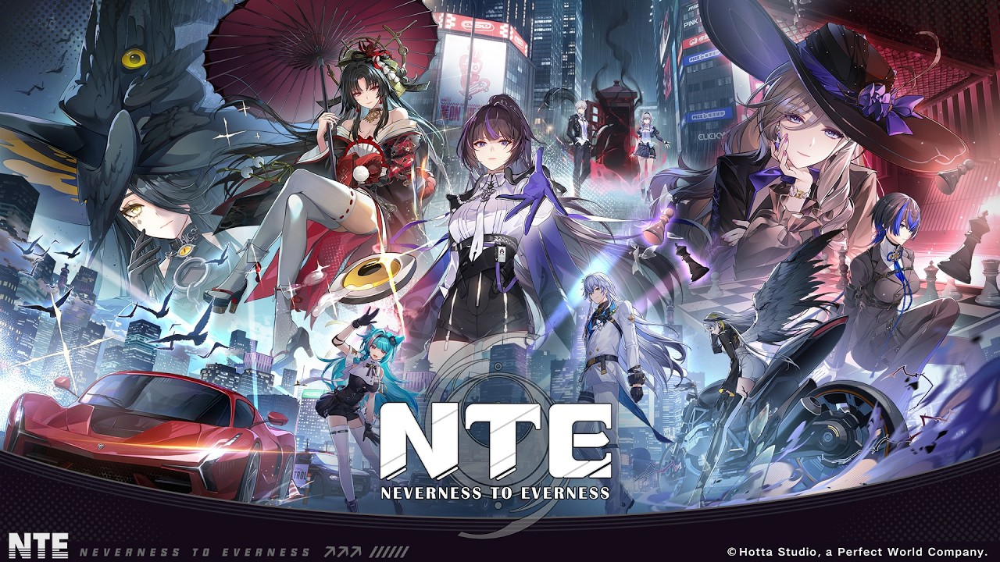

My name is Director Alphard. It is a pleasure meeting you.

So... you, another Anomaly Hunter, want to become a contractor of the BAC? Interesting.

Containing and nullifying anomalies is no easy task, rookie. Do you realise how dangerous of a job this really is?

...

Alright, if you insist... here's your refresher of everything that happened to Hethereau, the Bureau and our number 1 contractor business, Eibon Antique Shop.

Records of past missions, Espers we work with, places you can visit and general background information about Hethereau are all available for you to study in this record dump.

Next week, I am going to personally oversee your exam, and if you pass with good grades, I am going to take this as the start of a fruitful relationship between the Bureau and its new Contractor.

See you soon next week.
